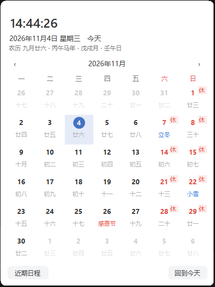
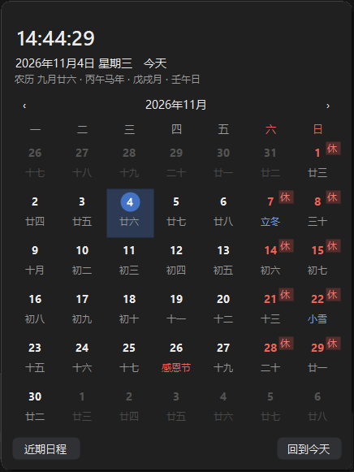
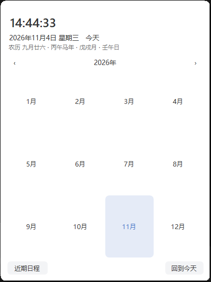
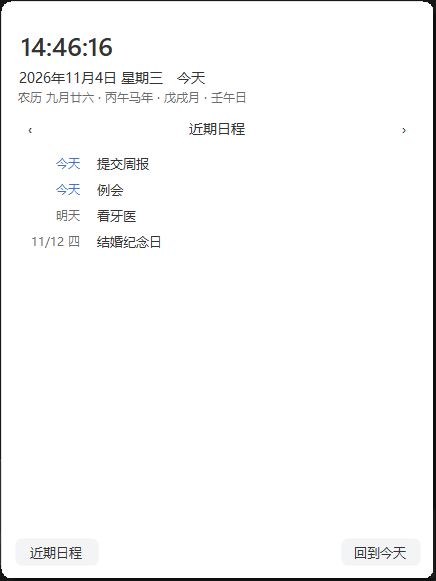
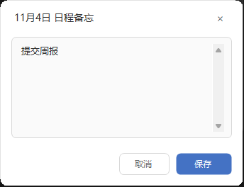

# 中国时间 · 任务栏时钟 + 日历面板 (ChinaTimeWidget)

**A tiny Windows taskbar clock replacement that always shows China Standard Time (UTC+8), with a Chinese lunar calendar flyout** — 农历、节气、节日、干支、法定假日调休、日程备忘与提醒。

把 Windows 11 任务栏右下角的系统时钟替换成**中国标准时间（北京时间 UTC+8）**，点击弹出月历面板。
单文件 C# / WinForms，零第三方依赖，**不修改系统时区、不改任何系统设置**，退出程序立即恢复原样。

## 截图

| | |
|---|---|
|  |  |
| 任务栏时钟：秒级中国时间 | 日历面板：农历/节气/节日/干支/休班角标 |
|  |  |
| 深色模式跟随系统 | 标题栏下钻：月历 → 选月 → 十年选年 |
|  |  |
| 近期日程：未来 14 天清单 | 双击日期编辑日程（支持每年/农历重复） |

## 功能

### 任务栏时钟（替代原系统时钟）
- 时间行格式可配置：秒/星期/日期行显隐，支持自定义 DateTime 格式串
- **第二时区双时钟**：时钟下追加一行其他时区（UTC/东京/纽约等，标签可改）
- **悬停提示**：完整日期 + 农历 + 干支 + 今日节日/节气 + 距最近假期倒计时
- 背景色自动适配任务栏（深色/浅色主题、Mica 材质采样）；explorer 重启自动对位；点击不抢焦点

### 日历面板（左键单击时钟打开/关闭）
- 农历、节气、节日、干支纪年月日；今天强调色圆圈；周数列（可选）
- **年月选择器**：点标题逐级下钻（月历 → 选月 → 十年选年），`‹` `›`/滚轮按当前层级翻页，
  点空白/Esc 收起——与 Windows 自带日历 / WinUI CalendarView / v-calendar 同款交互
- **日程备忘**：双击日期编辑，格底圆点标记，悬停显示清单；
  支持一次性、`每年 MM-DD`（公历每年）、`农历 MM-DD`（农历每年）三种格式
- **近期日程**：底部按钮打开未来 14 天清单，点条目跳转那天
- **日程提醒**：当日日程弹托盘气泡；内容开头带 `HH:mm ` 的到点单独提醒（按中国时间）
- **休/班角标**：法定假日与周末标"休"、调休补班标"班"；悬停显示节日名
- 深色模式跟随系统（可强制），强调色自定义；面板各视图均支持失焦回退

### 假日数据
- 角标优先级：**手动配置 > 在线数据（自动更新）> 内置规则**，都没有时周末标"休"
- 自动接入 [holiday-cn](https://github.com/NateScarlet/holiday-cn)（依据国务院公告的开源数据集）：
  每日拉取当年+次年数据（jsDelivr/raw 多镜像），公布次年安排后**无需更新程序**角标自动跟上
- 内置 13 天法定假日兜底；`holidays.txt` 手动配置优先级最高

## 安装与使用

要求：Windows 10/11，.NET Framework 4.8（系统自带），无需管理员权限。

1. 从 [Releases](https://github.com/oyjq0000/ChinaTimeWidget/releases) 下载 `TaskbarChinaClock.exe`，或按下方命令自行编译
2. 双击运行（单实例），时钟即刻覆盖系统时钟；左键单击打开日历面板
3. 右键时钟 →「设置…」调整全部选项；「开机自启」可一键注册（HKCU Run）

| 操作 | 功能 |
|---|---|
| 左键单击时钟 | 打开/关闭日历面板 |
| 悬停时钟 | 农历/节日/假期倒计时提示 |
| 点击面板标题（年月） | 逐级切换 月历 → 选月 → 选年 |
| 双击面板某天 | 编辑当日日程备忘 |
| 面板底部"近期日程" | 未来 14 天日程清单 |
| 右键 → 设置… | 打开设置窗口 |
| 右键 → 退出（恢复系统时钟） | 移除覆盖，原生时钟即刻回来 |

## 配置文件（均在 `%APPDATA%\ChinaClock\`）

| 文件 | 说明 |
|---|---|
| `settings.ini` | 全部设置（时钟格式/第二时区/周数/主题/强调色等），由设置窗口维护 |
| `holidays.txt` | 手动休/班配置，**优先级最高**：`休 2026-10-01 2026-10-08`、`班 2026-09-27` |
| `agenda.txt` | 日程：`日期\|内容` / `每年 MM-DD\|内容` / `农历 MM-DD\|内容`，内容开头可带 `HH:mm` |
| `holidays-cache.txt` | holiday-cn 在线数据缓存（自动维护） |
| `reminder-log.txt` | 日程提醒历史 |

## 构建与自测

零第三方依赖，使用 Windows 自带 .NET Framework 编译：

```
C:\Windows\Microsoft.NET\Framework64\v4.0.30319\csc.exe -nologo -target:winexe ^
  -out:TaskbarChinaClock.exe -r:System.dll -r:System.Drawing.dll -r:System.Windows.Forms.dll ^
  -r:C:\Windows\Microsoft.NET\assembly\GAC_MSIL\UIAutomationClient\v4.0_4.0.0.0__31bf3856ad364e35\UIAutomationClient.dll ^
  -r:C:\Windows\Microsoft.NET\assembly\GAC_MSIL\UIAutomationTypes\v4.0_4.0.0.0__31bf3856ad364e35\UIAutomationTypes.dll ^
  -r:C:\Windows\Microsoft.NET\assembly\GAC_MSIL\WindowsBase\v4.0_4.0.0.0__31bf3856ad364e35\WindowsBase.dll ^
  TaskbarChinaClock.cs
```

内置 39 项历法/数据自测：`TaskbarChinaClock.exe --selftest`（结果写入 `selftest-result.txt`）。
另有无鼠标视觉验证入口：`--show-panel` / `--settings` / `--agenda-demo` / `--list-demo` / `--picker-demo`。

## 数据来源与致谢

- [holiday-cn](https://github.com/NateScarlet/holiday-cn) — 法定假日/调休数据集（MIT）
- 农历：.NET 内置 `ChineseLunisolarCalendar`（1901–2100，天文级准确）；节气：寿星通用公式
- 交互设计参考：Windows 自带日历 / WinUI CalendarView、[v-calendar](https://github.com/nathanreyes/v-calendar)、[ElevenClock](https://github.com/marticliment/ElevenClock)

## 已知限制

- 系统日历面板（Win+N）、锁屏界面等处的时间无法替换，仍为本地时间
- 仅覆盖主显示器任务栏；与优效日历等"任务栏时钟增强"类软件共存会互相干扰
- 独占全屏（部分游戏）可能暂时盖住时钟；任务栏自动隐藏收起时时钟悬浮在原位置
- 农历数据支持 1901–2100 年；节气按寿星通用公式，个别年份可能偏差一天
- 勿扰模式开启时提醒横幅不弹（仍会进通知中心，并记录到 `reminder-log.txt`）

## License

[MIT](LICENSE)
